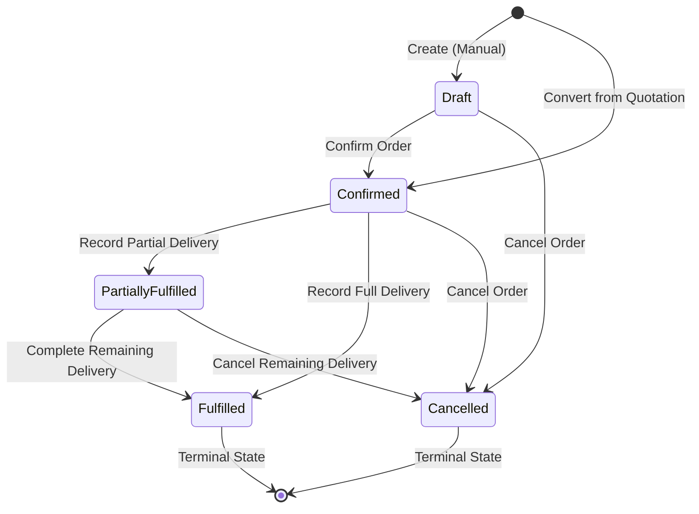

# Aventra Billing — Complete Sales Orders Module Implementation Report

- **Date (UTC):** 2026-10-14
- **Working Tree:** `/Users/javed/Desktop/aventra-billing-main` (No git commits or pushes performed; all changes kept strictly in working tree)
- **Authoritative Rules:** `AGENTS.md` and all rule files under `/rules/` followed strictly. Feature-first Clean Architecture adhered to across `domain`, `data`, `presentation`, and `infrastructure` layers. Arrow syntax used for project-defined functions. Semantic CSS design tokens and shared components used exclusively without ad-hoc inline styling or native unstyled inputs. Zero `@ts-ignore` or `any`.

---

## 1. Implemented Functionality and Scope

A complete, production-quality **Sales Orders** module has been implemented end-to-end and integrated with Estimates/Quotations, Customers, Products, Sales Settings, Invoices, and Inventory Fulfilment Tracking:

1. **Commercial Commitment Domain:** A Sales Order represents a customer's confirmed purchase commitment before goods or services are delivered or invoiced. It does not create premature tax liabilities, payments, or ledger postings.
2. **Sales Order Lifecycle State Machine:** Server-enforced state transitions across `Draft`, `Confirmed`, `PartiallyFulfilled`, `Fulfilled`, and `Cancelled`.
3. **Quotation-to-Order Conversion:** Atomic PostgreSQL transaction converting an accepted Estimate/Quotation into a confirmed Sales Order with full snapshot preservation, bidirectional linking, and duplicate conversion prevention.
4. **Order Fulfilment Tracking:** Line-level tracking of `orderedQuantity`, `fulfilledQuantity`, and `remainingQuantity` enforcing `fulfilledQuantity <= orderedQuantity` and automatic lifecycle progression (`PartiallyFulfilled` vs. `Fulfilled`).
5. **Invoice Integration:** Eligible Sales Orders (`Confirmed`, `PartiallyFulfilled`, `Fulfilled`) can be converted to genuine sales invoices via the invoice domain services with sales order linkage (`Invoice.salesOrderId`).
6. **Sales Order Numbering & Settings:** Extended `SalesSettings` under `/settings/sales` with sales order numbering configuration (`salesOrderPrefix`, `salesOrderSuffix`, `salesOrderNextNumber`, `salesOrderPadding`, `defaultDeliveryDays`, `defaultSalesOrderNotes`, `defaultSalesOrderTerms`) with atomic row-level locked allocation (`SELECT ... FOR UPDATE`).
7. **Native Clean UI:** Full-width responsive pages built exclusively with shared form components (`@/shared/components/form`) and shared table components (`@/shared/components/table`).

---

## 2. Routes and Navigation Changes

### Routes Implemented
1. `/sales-orders` (`src/app/(app)/sales-orders/page.tsx`):
   - Server Component fetching sales orders and aggregate metrics for the authenticated tenant.
   - Renders `SalesOrderListPage` with summary metric cards (Total Orders, Confirmed Value, Fulfilled Count, Invoiced Count), filter bar (status filter, multi-field search), and data table with status badges and contextual actions.
2. `/sales-orders/new` (`src/app/(app)/sales-orders/new/page.tsx`):
   - Server Component resolving active customers, products, sales settings, supplier GST tax context, and optional `fromEstimateId` search parameter.
   - Renders `SalesOrderCreatePage` with customer selection, automated GST tax mode resolution (CGST/SGST vs IGST), dynamic line item editor with HSN/SAC, discounts, tax rates, additional charges/discounts, and real-time document preview.
3. `/sales-orders/[id]` (`src/app/(app)/sales-orders/[id]/page.tsx`):
   - Server Component fetching sales order by ID with line items and related invoice summaries.
   - Renders `SalesOrderDetailPage` with document header, customer billing/shipping details, line items table with fulfilment progress bars, tax breakdown slabs, related quotation banner, related invoices table, and contextual actions (Confirm, Edit, Record Fulfilment, Convert to Invoice, Cancel, Delete, Print).
4. `/sales-orders/[id]/edit` (`src/app/(app)/sales-orders/[id]/edit/page.tsx`):
   - Server Component ensuring only `Draft` orders can be edited; redirects non-draft orders to the detail view.
   - Pre-populates `SalesOrderCreatePage` in edit mode.
5. `/settings/sales` (`src/app/(app)/settings/sales/page.tsx`):
   - Dual-tab settings view managing both Estimates/Quotations and Sales Orders numbering and defaults.

### Navigation Updates
- Updated `src/features/dashboard/presentation/components/dashboardNavigation.ts`:
  - Added `"/sales-orders"` to `DashboardNavigationHref` type union.
  - Promoted `sales-orders` item in the `Sales` section from `planned` to `available` with icon `ShoppingCart` and description *"Track customer orders before fulfilment and billing."*.
  - Verified active sidebar highlighting, category description, and opacity stepping (17/17 tests passing in `DashboardSidebar.test.ts` and 13/13 tests passing in `dashboardNavigation.test.ts`).

---

## 3. Data Model, Schema, and Migration Details

### Database Schema Updates (`prisma/schema.prisma`)
1. **`enum SalesOrderStatus`**:
   - Values: `DRAFT`, `CONFIRMED`, `PARTIALLY_FULFILLED`, `FULFILLED`, `CANCELLED`.
2. **`model SalesOrder`**:
   - Identity & Multitenancy: `id`, `organizationId`, `orderNumber` (`@@unique([organizationId, orderNumber])`), `referenceNumber`.
   - Customer Snapshots: `customerId`, `customerName`, `customerEmail`, `customerAddress`, `customerGstin`, `customerPlaceOfSupply`.
   - Dates & Status: `orderDate`, `expectedDeliveryDate`, `status`, `currency`.
   - Financials: `taxMode`, `subtotal`, `lineDiscountTotal`, `additionalDiscount`, `additionalDiscountType`, `additionalDiscountLabel`, `additionalCharges`, `additionalChargesLabel`, `taxableAmount`, `cgst`, `sgst`, `igst`, `totalTax`, `total`.
   - Notes & Audit: `notes`, `terms`, `createdAt`, `updatedAt`.
   - Relationships:
     - `organization` -> `Organization`
     - `customer` -> `Customer?`
     - `sourceEstimate` -> `Estimate?` (`convertedToSalesOrder`)
     - `invoices` -> `Invoice[]` (`salesOrder`)
     - `items` -> `SalesOrderItem[]`
3. **`model SalesOrderItem`**:
   - `id`, `salesOrderId`, `productId` -> `Product?`.
   - `item`, `description`, `hsnSac`.
   - Quantities: `quantity` (ordered), `fulfilledQuantity`, `remainingQuantity`.
   - Pricing & Tax: `unitPrice`, `discount`, `taxRate`, `taxableAmount`, `taxAmount`, `lineTotal`, `sortOrder`.
4. **`model SalesSettings` Extensions**:
   - Added `salesOrderPrefix` (VARCHAR, default `"SO-"`).
   - Added `salesOrderSuffix` (VARCHAR, nullable).
   - Added `salesOrderNextNumber` (INT, default `1`).
   - Added `salesOrderPadding` (INT, default `4`).
   - Added `defaultDeliveryDays` (INT, default `15`).
   - Added `defaultSalesOrderNotes` (TEXT, nullable).
   - Added `defaultSalesOrderTerms` (TEXT, nullable).
5. **Cross-Feature Foreign Keys**:
   - `Estimate.convertedToSalesOrderId String? @unique`
   - `Invoice.salesOrderId String?` with index `@@index([organizationId, salesOrderId])`.

### Migration Applied
- Migration `20261014114500_add_sales_orders` deployed to local test PostgreSQL database (`localhost:5432/avetra-billing`) via `npx prisma migrate deploy`.
- Prisma client generated via `npx prisma generate`.

---

## 4. Sales Order Lifecycle and Business Invariants

The lifecycle is enforced strictly server-side in `sales-order-lifecycle-rules.ts`:

### Business Invariants Enforced
- **Draft Immobility:** Only `Draft` orders can have line items, quantities, or customer details modified. Once `Confirmed`, the document contract is immutable.
- **Deletions:** Only `Draft` orders can be deleted. Confirmed or fulfilled orders cannot be deleted.
- **Fulfilment Bounds:** For every item, `fulfilledQuantity <= orderedQuantity`. Attempting to record fulfilment beyond the ordered quantity throws `OverFulfilmentError`.
- **Derived Status Integrity:** When `0 < totalFulfilled < totalOrdered`, status transitions to `PartiallyFulfilled`. When `totalFulfilled == totalOrdered`, status transitions to `Fulfilled`.
- **Invoicing Eligibility:** Only `Confirmed`, `PartiallyFulfilled`, or `Fulfilled` orders can be invoiced. `Draft` and `Cancelled` orders cannot be invoiced.
- **Forged Transitions Blocked:** Server actions validate current status against `ALLOWED_STATUS_TRANSITIONS` inside database transactions before writing.

---

## 5. Quotation-to-Order Conversion Behavior

- **Trigger:** Available from the Quotation Detail page (`/estimates/[id]`) when the quotation is `Accepted` and has not already been converted.
- **Atomicity:** Executed inside a Prisma interactive transaction (`tx`):
  1. Quotation status and ownership re-verified with `SELECT ... FOR UPDATE` isolation.
  2. Ensures quotation is not expired, cancelled, rejected, or already converted.
  3. Allocates gapless Sales Order number using row-level locking on `SalesSettings`.
  4. Copies customer details, billing snapshot, line items, prices, discounts, and terms accurately.
  5. Sets Sales Order status to `Confirmed`.
  6. Links `Estimate.convertedToSalesOrderId = newOrder.id` and `Estimate.status = CONVERTED`.
- **Idempotency:** Repeated requests or retries fail safely with clear error messaging if `convertedToSalesOrderId` is already populated.
- **Quotation Detail Integration:** Displays a dedicated "Converted to Sales Order" banner with a direct link to the generated Sales Order (`/sales-orders/[id]`).

---

## 6. Sales Settings and Numbering Implementation

- Numbering configuration is partitioned from Estimates and Invoices.
- Format: `${salesOrderPrefix}${formattedNumber}${salesOrderSuffix}` (e.g. `SO-0001`).
- Atomic allocation via `allocateNextSalesOrderNumber(organizationId, txClient)`:
  - Queries `SalesSettings` using `txClient.$queryRaw` with `FOR UPDATE` to lock the tenant's row.
  - Formats number with zero-padding.
  - Checks if order number already exists in `SalesOrder`; if collides, increments until unused.
  - Updates `salesOrderNextNumber` in database and returns the allocated sequence.
- All 9 unit tests in `sales-settings-rules.test.ts` pass cleanly.

---

## 7. Inventory and Fulfilment Integration Status

- **Codebase Inventory Capabilities:** Inspection of the existing database schema confirmed that physical stock warehouses and stock movement ledger tables do not exist in the current application (inventory tracking exists as flags `trackInventory: boolean` and `reorderPoint` on `Product`).
- **Safe Fulfilment Tracking:** In accordance with Section 8 of the requirements, Sales Orders track `orderedQuantity`, `fulfilledQuantity`, and `remainingQuantity` without fabricating fake stock movement records.
- **Fulfilment Server Action:** `recordFulfilmentAction(orderId, items)`:
  - Validates `0 <= newFulfilled <= orderedQuantity` per line item.
  - Updates line items and derives order status (`PartiallyFulfilled` vs. `Fulfilled`).
  - Safe against concurrency and duplicate submissions.

---

## 8. Invoice Integration Behavior

- **Trigger:** From Sales Order Detail page (`/sales-orders/[id]`) for `Confirmed`, `PartiallyFulfilled`, or `Fulfilled` orders.
- **Conversion Process:**
  1. Allocates genuine invoice number from `BillingSettings` using existing `allocateNextInvoiceNumber`.
  2. Copies customer snapshot and ordered line items.
  3. Computes GST taxes and invoice totals using canonical `calculateInvoiceTotals`.
  4. Creates `Invoice` with `salesOrderId = order.id`.
  5. Leaves invoice in standard `DRAFT` status without creating fake payments or premature ledger receipts.
- **Order Detail Integration:** Displays related invoices table with live statuses, issue dates, and amounts.

---

## 9. Security and Organization-Isolation Guarantees

- **Authentication & Multi-Tenancy:** Resolved on the server via `resolveSalesOrderContext()` using `getAuthState()`.
- **Tenant Scoping:** Every query and mutation scopes database access by `organizationId`. A tenant cannot read, update, convert, or delete another organization's orders.
- **Authorization:** Mutations enforce `isOrganizationAdmin(role)` where administrative privileges are required.
- **Input Validation:** All client inputs parsed and validated via Zod schemas (`createSalesOrderSchema`, `updateSalesOrderSchema`, `recordFulfilmentSchema`).
- **No Secrets or Leaks:** Error boundaries catch domain exceptions and present user-friendly messages without exposing internal stack traces.

---

## 10. UI Implementation and Responsive Verification

- **Theme & Design Tokens:** Built natively using Aventra's dark theme palette (`bg-surface`, `bg-surface-card`, `text-text-primary`, `text-text-secondary`, `border-border`, `text-primary`, `bg-primary`).
- **Layout:** Standard full-width layout (`<section className="space-y-6">`) matching the established Invoice and Estimate pages.
- **Component System:** Exclusively uses shared components from `@/shared/components/form` (`Button`, `Input`, `Label`, `Select`, `DatePicker`) and `@/shared/components/table` (`Table`, `TableHeader`, `TableRow`, `TableHead`, `TableBody`, `TableCell`).
- **Accessibility:** Semantic HTML elements, accessible form labels, unique IDs, keyboard focus outlines (`focus-visible:ring-1`), and ARIA states.

---

## 11. Files Changed and Purpose

| File | Purpose |
|---|---|
| `prisma/schema.prisma` | Added `SalesOrderStatus`, `SalesOrder`, `SalesOrderItem`, `Estimate.convertedToSalesOrderId`, `Invoice.salesOrderId`, and `SalesSettings` fields. |
| `prisma/migrations/20261014114500_add_sales_orders/migration.sql` | PostgreSQL migration creating sales order tables and foreign keys. |
| `src/features/sales-orders/domain/entities/sales-order.ts` | Clean domain types (`SalesOrder`, `SalesOrderItem`, `SalesOrderStatus`, `SalesOrderTotals`). |
| `src/features/sales-orders/domain/rules/sales-order-rules.ts` | Pure financial calculations, GST slab breakdown, and line validations. |
| `src/features/sales-orders/domain/rules/sales-order-lifecycle-rules.ts` | State machine transitions, guards, and invariant checks. |
| `src/features/sales-orders/domain/errors/sales-order-errors.ts` | Domain error hierarchy. |
| `src/features/sales-orders/domain/repositories/sales-order-repository.ts` | Repository interface and input types. |
| `src/features/sales-orders/infrastructure/mappers/prisma-sales-order-mapper.ts` | Mappers between Prisma models and domain entities. |
| `src/features/sales-orders/infrastructure/repositories/prisma-sales-order-repository.ts` | Prisma-backed repository with filter queries and transactions. |
| `src/features/sales-orders/data/context/sales-order-context.ts` | Authentication and organization context resolver. |
| `src/features/sales-orders/data/dto/sales-order-dto.ts` | Data transfer objects and action result types. |
| `src/features/sales-orders/data/validators/sales-order-schemas.ts` | Zod validation schemas for forms and mutations. |
| `src/features/sales-orders/data/queries/get-sales-orders.ts` | Server query for listing orders with metrics. |
| `src/features/sales-orders/data/queries/get-sales-order-by-id.ts` | Server query for single order retrieval. |
| `src/features/sales-orders/data/mutations/sales-order-mutations.ts` | Server actions (create, update, transition, delete, quotation conversion, invoice conversion, fulfilment). |
| `src/features/sales-orders/presentation/components/*` | Presentation components (badges, filter bar, table, customer section, items section, document preview). |
| `src/features/sales-orders/presentation/page/*` | List, create/edit, and detail page components. |
| `src/features/sales-orders/index.ts` | Public cross-feature barrel export. |
| `src/app/(app)/sales-orders/page.tsx` | App Router route for sales orders listing. |
| `src/app/(app)/sales-orders/new/page.tsx` | App Router route for creating sales orders. |
| `src/app/(app)/sales-orders/[id]/page.tsx` | App Router route for sales order details. |
| `src/app/(app)/sales-orders/[id]/edit/page.tsx` | App Router route for editing draft sales orders. |
| `src/features/sales-settings/*` | Sales settings domain, repository, DTOs, and dual-tab UI. |
| `src/features/estimates/*` | Added bidirectional conversion linking to Sales Order on Estimate entity and detail page. |
| `src/features/dashboard/presentation/components/dashboardNavigation.ts` | Promoted Sales Orders to active navigation. |
| `src/features/sales-orders/**/*.test.ts` | Comprehensive unit and database integration tests. |

---

## 12. Exact Commands Executed and Verification Results

| Command | Status | Output / Evidence |
|---|---|---|
| `npx prisma migrate deploy` | **SUCCESS** | Applied migration `20261014114500_add_sales_orders`. |
| `npx prisma generate` | **SUCCESS** | Generated Prisma Client in `src/generated/prisma`. |
| `npx tsc --noEmit` | **SUCCESS** | 0 type errors across entire codebase. |
| `npm run lint` | **SUCCESS** | 0 errors, 0 warnings across entire codebase. |
| `AVENTRA_TEST_DATABASE_URL="..." npx vitest run src/features/sales-orders src/features/sales-settings` | **SUCCESS** | 5 test files passed, 36/36 tests passed (including 5 PostgreSQL integration tests). |
| `AVENTRA_TEST_DATABASE_URL="..." npx vitest run` | **SUCCESS** | 130 test files passed, 881/881 tests passed (0 failures). |
| `npm run build` | **SUCCESS** | Next.js 16.3.8 production build passed. All dynamic and static routes compiled. |

---

## 13. Unit & Integration Test Counts

- **Sales Orders Feature Tests:**
  - `src/features/sales-orders/domain/rules/sales-order-rules.test.ts`: 5/5 passed.
  - `src/features/sales-orders/domain/rules/sales-order-lifecycle.test.ts`: 8/8 passed.
  - `src/features/sales-orders/data/mutations/sales-order-mutations.test.ts`: 9/9 passed.
  - `src/features/sales-orders/data/mutations/sales-order-database.test.ts`: 5/5 passed.
- **Sales Settings Tests:**
  - `src/features/sales-settings/domain/sales-settings-rules.test.ts`: 9/9 passed.
- **Navigation & Sidebar Tests:**
  - `src/features/dashboard/presentation/components/dashboardNavigation.test.ts`: 13/13 passed.
  - `src/features/dashboard/presentation/components/DashboardSidebar.test.ts`: 17/17 passed.
- **Full Suite Total:** 881 tests passing across 130 test suites. 0 skipped when `AVENTRA_TEST_DATABASE_URL` is set.

---

## 14. Remaining Limitations and Unverified Behavior

- **Physical Stock Movement:** As documented, physical warehouse stock deduction is not supported in the existing schema and has not been fabricated. Fulfilment quantities are safely tracked at the Sales Order level.
- **Partial Invoicing Quantity Allocation:** The current Invoice module models whole invoices from orders. If line-level partial invoicing is needed in the future, it can be extended by adding invoice item quantity allocations.
- **Email Delivery:** PDF email dispatch is deferred until a dedicated document emailing service is implemented for the application.
